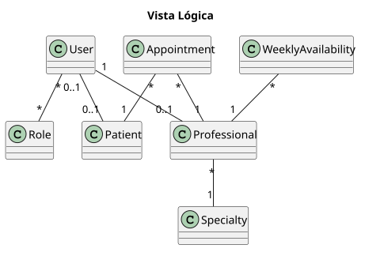
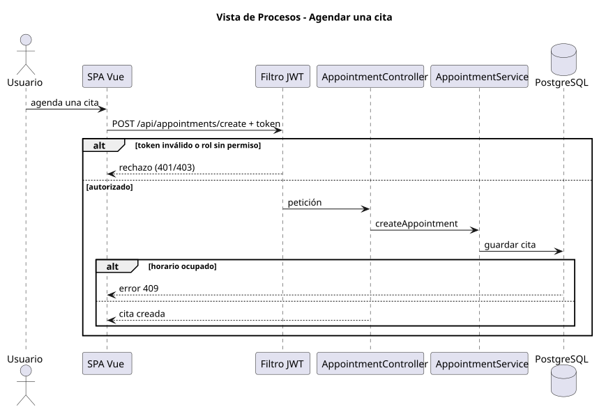
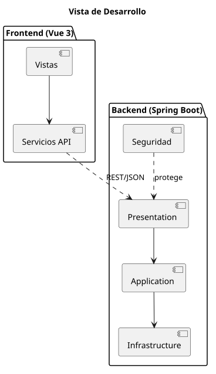
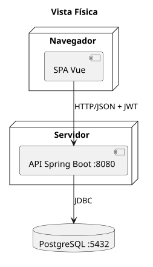
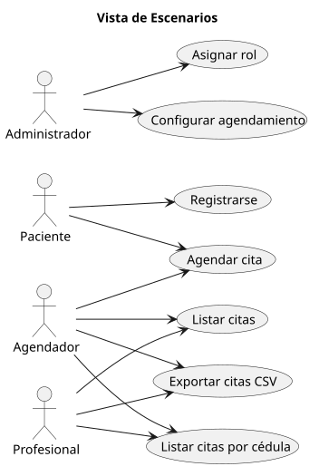

# Vistas de arquitectura 4 + 1

Diagramas de arquitectura de Piedrazul organizados según el modelo 4 + 1. Cada vista incluye su fuente PlantUML y exportaciones SVG y PNG.

## Vista lógica

## Vista de procesos

## Vista de desarrollo

## Vista física

## Escenarios

